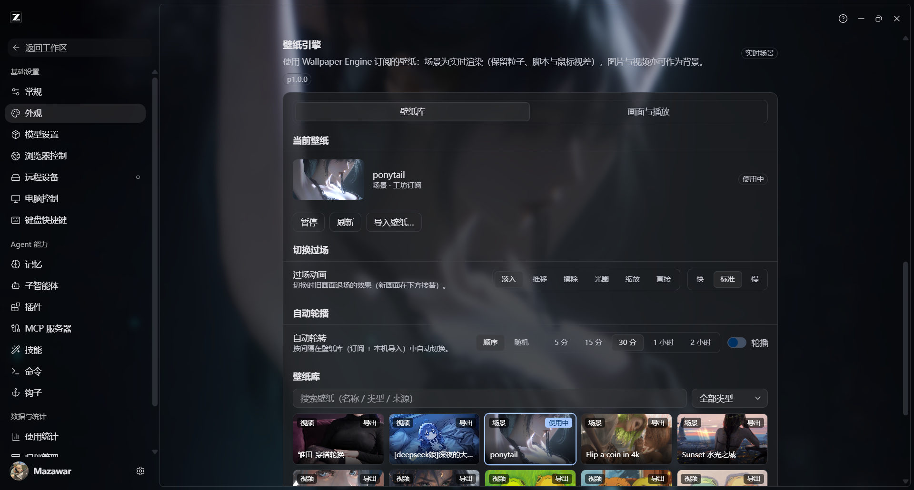
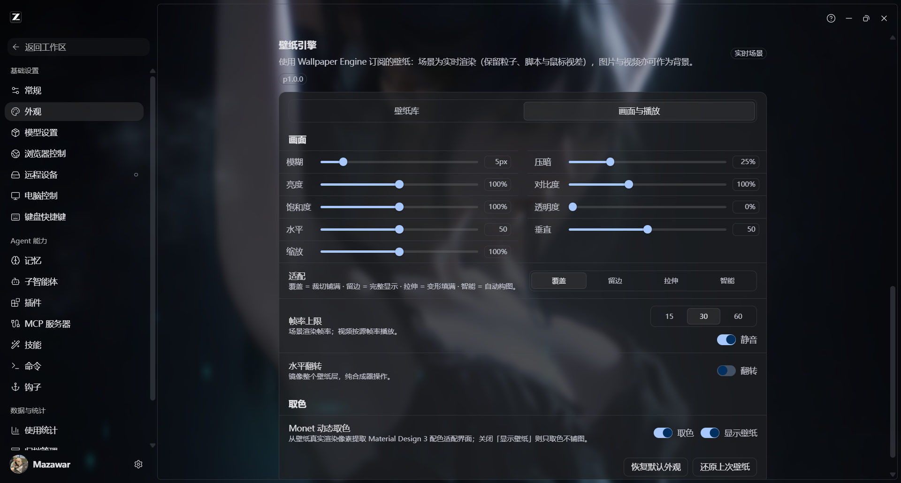

# zcode-wallpaper

**把 Wallpaper Engine 订阅的壁纸实时渲染进 ZCode 桌面客户端**——粒子、SceneScript、鼠标视差全部保留，不录屏、不需要 Wallpaper Engine 常驻；再配上 Material Design 3（Monet）动态取色，与 ZCode「设置 → 外观」页原生融合的配置面板。



> 图为 1.0 实拍：外观页底部的「壁纸引擎」区块（壁纸库页签——当前壁纸卡片、切换过场、自动轮播、壁纸库网格），与 ZCode 原生设置同款视觉；壁纸在其后实时渲染。

## 特性

| 能力 | 说明 |
|---|---|
| **实时场景渲染** | WebWallGL（WebGL2）直接解析渲染 `scene.pkg` / 松散工程：粒子、puppet 骨骼、SceneScript、音频反应全保留，满画质（MSAA×4，分辨率跟随设备 DPR） |
| **鼠标视差** | 真实指针位置实时驱动壁纸交互 |
| **壁纸库** | 自动发现 Steam 工坊订阅（431960）+ WE 工程 + 本机导入；搜索 / 类型筛选 / 分页 / 预览海报 |
| **统一导入** | 一个入口接受图片、`.zw.zip` 资源包、`.pkg` 场景、`.mp4/.webm` 视频（裸 pkg 自动合成元数据） |
| **跨机迁移** | 每张壁纸一键导出 `.zw.zip`；另一台**没有 Steam / WE 的电脑**浏览器选择器导入即用 |
| **切换体验** | 六种过场（淡入/推移/擦除/光圈/缩放/直接）、自动轮播、视频原生播放、失败自动回退预览图并带原因+一键重试 |
| **Monet 动态取色** | 从壁纸真实渲染首帧提取 MD3 配色适配整个界面 |
| **画面调节** | 亮度/对比度/饱和度/透明度/位置/缩放/翻转、模糊、压暗、帧率上限（15/30/60）、静音 |
| **Agent 工具** | 7 个 MCP 工具 + `/wallpaper` 命令 + 技能（列出/应用/调参/重置/状态） |
| **可靠生命周期** | 停用 / 卸载 / 应用退出均自动恢复默认外观；跨平台（Windows / macOS / Linux）启动链 |

## 安装

### 插件市场（推荐）

插件市场 → 添加 → 添加插件市场，粘贴本仓库地址（GitHub），添加后在「个人」页找到 **ZCode 壁纸引擎** 点击安装。装完**完全退出 ZCode，再双击图标启动**（ZCode 快捷方式会被自动改为「先静默拉起壁纸服务、再启动 ZCode」——包装脚本永不可能阻塞启动：node 或插件缺失时跳过服务，ZCode 照常打开；此后开机即生效）。

### 离线安装

从 [Releases](../../releases) 下载 `zcode-wallpaper-x.y.z.zip`，按 ZCode 本地插件方式安装。

## 使用

- **面板**：ZCode 设置 → 外观 页底部「壁纸引擎」区块——壁纸库、导入、过场、轮播、画面调节、取色开关都在这里（标题旁的 `p1.x.y` 徽章是面板构建版本）。「画面与播放」页签负责画质微调：

  
- **CLI**：`node dist/cli.js launch | apply <path-or-id> | wallpapers | colors | reset | status | serve`
- **Agent**：对 ZCode 里的助手说「换个壁纸」即可（或 `/wallpaper`）；工具见技能 `wallpaper`。

## 没有 Wallpaper Engine 的机器能用吗？

能。Steam/WE 只影响「自动列出工坊订阅」；`.zw.zip` / 裸 `.pkg` / 视频 / 图片导入完全不依赖它们——A 电脑导出 → B 电脑装插件 → 导入即用。

## 工作原理（两分钟版）

```
Steam 工坊订阅 ──枚举──▶ serve (127.0.0.1:28257)
                          ├─ /agent.js /panel.js   页面运行时（真文件，部署即最新）
                          ├─ /live/index.html      WebWallGL 渲染页
                          ├─ /api/events           SSE 配置通道
                          └─ /api/…                配置/壁纸库/导入导出/传输账本
ZCode ◀── CDP 注入 (28256) ── 瘦 bootstrap（仅注册一次 + 生命周期心跳）
```

页面里的壁纸层由**声明式状态机**驱动（12 相位，转移表唯一权威），实时渲染失败分级处理（传输未完成=自动重试，渲染器故障=回退预览图并显示原因）；对 ZCode 界面本身**只做声明式样式，不改动任何宿主 DOM**。

> 边界说明：ZCode 目前没有官方外观/注入 API（社区生态全部经 CDP，见 [feedback #171](https://github.com/zai-org/feedback/issues/171)），本插件保持非破坏性：不修改 ZCode 安装文件，`恢复默认外观` / 卸载 / 停用均可一键或自动还原。

架构与决策档案见 [`docs/`](docs/)：[ARCHITECTURE](docs/ARCHITECTURE.md) · [DECISIONS](docs/DECISIONS.md) · [STATE](docs/STATE.md) · [GUARD-MAP](docs/GUARD-MAP.md)。

## 已知边界

- 保真度取决于 WebWallGL 对 WE 引擎语义的复刻，个别工坊场景可能与本体有细微差异（引擎诊断打到 serve 日志 `[live:*]`）。
- Application 类壁纸（需宿主运行第三方可执行）有意不支持。
- 换壁纸的耗时 = 场景下载与装配时间（小场景约 1–2 秒）；传输期间有字节账本防止误判失败。

## 开发

```bash
npm install && npm run build     # tsc + esbuild 打包（live/src → live/*.js，产物入库）
npm run verify                   # 4 条守卫：状态机/双向对账/守卫地图/产物契约
npm run market                   # 导出干净本地市场 .local-market/（约 5MB，勿以仓库根当市场）
node scripts/e2e.mjs             # 端到端闸门（需 serve 运行中 + ZCode 带 CDP 端口）
```

改运行时代码一律改 `live/src/**` 后重新构建，不手改产物。守卫地图（改哪个文件跑哪条验证）见 `docs/GUARD-MAP.md`。

## 致谢与许可

- [webwallgl](https://github.com/oneincase/webwallgl)（MIT, © oneincase）— 渲染核心
- [zcode-beautify](https://github.com/Logocceai/zcode-beautify)（MIT, © Logocceai）— CDP 注入 / Monet / 启动器模块来源
- [dsh-wallpaper-engine](https://github.com/elysia395/dsh-wallpaper-engine)（MIT）— 实时渲染架构与稳定性机制参考

Wallpaper Engine 创意工坊素材版权归各自作者；请只使用你自己拥有或已订阅的内容，勿分发他人作品。
