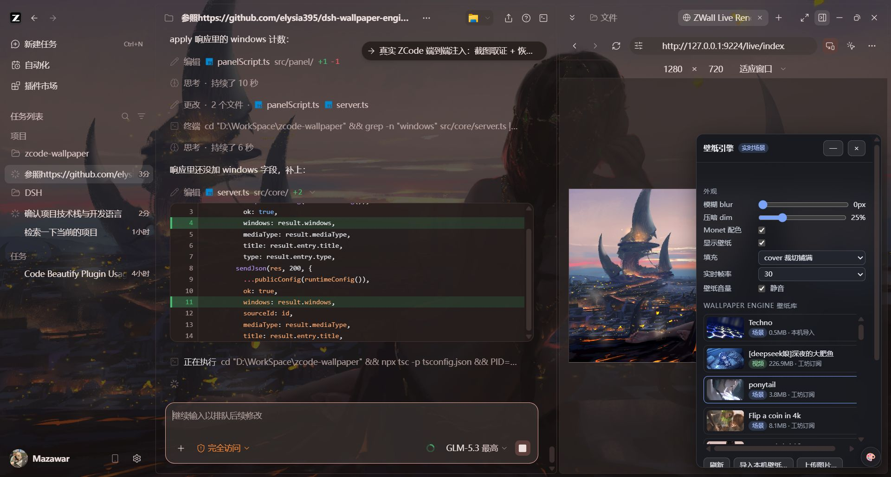

# zcode-wallpaper

**把 Wallpaper Engine 订阅的场景壁纸实时渲染进 ZCode 桌面客户端** —— 粒子、SceneScript、鼠标视差全部保留，不录屏、不需要 Wallpaper Engine 常驻；再配上 Material Design 3（Monet）动态取色，注入 ZCode 原生「设置 → 外观」页的自定义配置区块。



> 端到端实测：工坊订阅场景「Sunset 水光之城」（WLOP）在 ZCode 界面背后由 WebWallGL 实时渲染，配置区块与原生设置同款样式。

## 特性

| 能力 | 说明 |
|---|---|
| **实时场景渲染** | WebWallGL（WebGL2）直接解析渲染 `scene.pkg` / 松散工程，保留粒子、puppet 骨骼、SceneScript、音频反应 |
| **鼠标视差** | 界面上的真实鼠标位置实时驱动壁纸（指针桥 postMessage 转发） |
| **满画质** | MSAA×4、视频纹理不压缩、禁用自动降档，渲染分辨率跟随设备 DPR —— 壁纸啥样这里就啥样 |
| **平滑切换** | 双 iframe 交叉淡入（预览图占位→就绪淡入→旧层移除），零黑屏零闪烁；改帧率/填充/静音走热更新，不重载 |
| **订阅枚举** | 自动发现 Steam 各库的工坊订阅（431960）+ WE 内置/我的工程，支持多 Steam 库 |
| **壁纸库** | 设置→外观页原生样式区块：搜索（名称/类型/来源）、分页（固定高度不塌缩）、类型徽标、预览图 |
| **跨机迁移** | 每张壁纸一键导出 `.zw.zip` 资源包；另一台电脑（无需 Steam/WE）浏览器文件选择器导入即用 |
| **统一导入** | 「导入壁纸…」一个入口接受图片 / `.zw.zip` / `.pkg` 场景 / `.mp4`/`.webm` 视频（裸 pkg 自动合成元数据） |
| **删除管理** | 本机导入项可删除（使用中自动切换），文件后台重试清理（规避 Windows 句柄锁定） |
| **Monet 动态取色** | 从壁纸真实渲染首帧提取 MD3 配色适配界面（首帧回传机制），两段推送不阻塞切换 |
| **视频/图片壁纸** | 视频 Range 流式播放（WE 视频本就无缝），图片三种构图（cover/contain/smart 智能主体分析） |
| **Agent 工具** | MCP 工具 7 个（`list_wallpapers`、`import_scene_wallpaper`、`apply_options`…），`/wallpaper` 命令 + 技能 |

## 工作原理

```
Steam 工坊订阅 ──枚举──▶ serve (127.0.0.1:28257)
   (注册表 → libraryfolders.vdf        ├─ /files/<id>/…     壁纸静态文件（Range + ETag/304，穿越防护）
    → workshop/content/431960)         ├─ /live/index.html  WebWallGL 渲染页（vendored 引擎）
                                       └─ /api/…            配置 / 壁纸库 / 导入导出 / 删除
                                              │
ZCode ◀── CDP 注入 (28256) ── 底层 iframe 壁纸层 ◀── 指针/滚轮桥 ── ZCode UI
   Page.addScriptToEvaluateOnNewDocument + Page.setBypassCSP
```

- **渲染核心**是开源引擎 [webwallgl](https://github.com/oneincase/webwallgl)（MIT，npm v3）：它的 `httpSource` 只要求把壁纸目录当静态文件供给，其余（解析、装配、渲染循环、脚本沙箱、指针与音频）全部内置。
- **注入通道**沿用 [zcode-beautify](https://github.com/Logocceai/zcode-beautify)（MIT）的 CDP 方案与 Monet 模块；Steam/WE 发现链路参考了 [dsh-wallpaper-engine](https://github.com/elysia395/dsh-wallpaper-engine)（MIT）的宿主契约。
- 与「开 WE 窗口录屏→ffmpeg 循环」的方案相比：不丢交互、不依赖 WE/ffmpeg 常驻、跨平台、秒级导入。

## 安装

### 作为插件安装（推荐）

从 [Releases](../../releases) 下载 `zcode-wallpaper-x.y.z.zip`，按 ZCode 本地插件方式安装（含 `.zcode-plugin/plugin.json`、MCP 服务、`/wallpaper` 命令与技能）。插件随 ZCode 启动自动拉起 serve 与面板。

### 从源码运行

```bash
git clone https://github.com/<you>/zcode-wallpaper && cd zcode-wallpaper
npm install && npm run build        # tsc + vendor WebWallGL 引擎
node dist/cli.js launch             # 带 CDP 端口拉起 ZCode（完全退出后执行；快捷方式会被自动更新）
node dist/cli.js serve --detach     # 常驻服务（API 28257，注入 CDP 28256）
```

端口：CDP **28256**、API **28257**（`serve --port/--api-port` 可覆盖）。

## 使用

- **面板**：ZCode 设置 → 外观 页底部「壁纸引擎」区块（仅此页显示，切页即隐）——壁纸库（搜索/分页/导出/删除）、「导入壁纸…」统一文件选择器、背景模糊/压暗、填充方式、实时帧率（15/30/60）与静音、Monet 开关（ZCode 原生开关样式）。
- **CLI**：`launch | apply <path-or-id> | wallpapers | colors | reset | status | serve`
- **MCP 工具**：`set_background` / `list_wallpapers` / `import_scene_wallpaper` / `apply_options` / `refresh_theme` / `reset_appearance` / `wallpaper_status`

## 无 Wallpaper Engine 的机器能用吗？

能。Steam/WE 只影响「自动列出工坊订阅」；`.zw.zip` 资源包 / 裸 `.pkg` / 视频 / 图片导入完全不依赖它们 —— A 电脑导出 → B 电脑装本插件 → 导入即用。

## 已知边界

- 保真度取决于 WebWallGL 对 WE 引擎语义的复刻，个别工坊场景可能与 Wallpaper Engine 本体有差异（引擎诊断打到 serve 控制台 `[live:*]`）。
- Application 类壁纸（需宿主运行第三方可执行文件）有意不支持。
- 壁纸自带音频默认静音，可在面板/工具开启。
- 修改面板脚本后重新部署需递增其内部版本号（页面注册脚本的生命周期长于 serve 进程，协议见源码注释）。

## 目录结构

```
src/core/    steam.ts(发现/枚举) server.ts(serve) cdp.ts(注入) inject.ts(载荷)
             monet.ts(tokens.ts) media.ts(静态服务) session.ts(CLI/MCP 共用操作)
src/panel/   设置页区块（注入脚本）
src/mcp/     MCP 服务器（7 个工具）
live/        WebWallGL 渲染页（index.html + renderer.js）
commands/ skills/ scripts/  /wallpaper 命令、技能、构建脚本
```

## 致谢与许可

- [webwallgl](https://github.com/oneincase/webwallgl)（MIT, © oneincase）— 渲染核心
- [zcode-beautify](https://github.com/Logocceai/zcode-beautify)（MIT, © Logocceai）— CDP 注入 / Monet / 启动器模块来源
- [dsh-wallpaper-engine](https://github.com/elysia395/dsh-wallpaper-engine)（MIT）— 实时渲染架构与 Steam 发现参考

Wallpaper Engine 创意工坊素材版权归各自作者；请只使用你自己拥有或已订阅的内容，勿分发他人作品。
